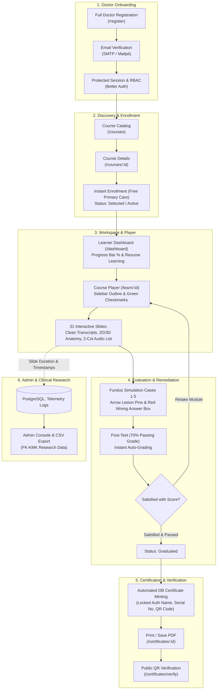

# STRATEGIC & PHASED IMPLEMENTATION BLUEPRINT: DRIVE-LEARN LMS (FK-KMK UGM)

> **Project:** DRIVE-Learn Interactive LMS Platform  
> **Partnership:** PT Tekno Global Infotama & Department of Ophthalmology, FK-KMK UGM  
> **Contract Reference:** Cooperation Agreement No. 001/PKS-TGI/VIII/2026 & 818/UN.1/FK-KMK.2/MT2/KS/2026  
> **Contract Value:** IDR 35,000,000 (Fixed Price, Non-VAT/Non-PKP)  
> **Timeline:** 16 Calendar Weeks (4 Months)  
> **Lead Software Architect & Tech Lead:** Ariefan Dipokusumo Wibowo, S.Kom., M.Cs.
> **Last Updated:** 2026-10-15 — added scope-trim & gap-closure execution checklist (Phases 0–6) after the PKS-vs-implementation audit

---

## 1. Executive Summary & Critical Context

The customer is the **Department of Ophthalmology, Faculty of Medicine, Public Health, and Nursing (FK-KMK) Universitas Gadjah Mada (DRIVE Program Team)**, led by **Prof. dr. Muhammad Bayu Sasongko, M.Epi., Ph.D., Sp.M**. This project delivers a targeted, specialized interactive e-learning platform for **Diabetic Retinopathy (DR) Screening tailored for Primary Care Doctors (Puskesmas & Pratama Clinics)** across Indonesia.

This is **not a generic bloated university LMS** burdened with forum threads, semester timetabling, or heavy campus RFID check-ins. It is an ultra-focused clinical delivery system:
1. High-yield medical training on diabetic retinopathy via lightweight 2D interactive slides.
2. Clinical fundus image grading simulation (microaneurysms, hard exudates, hemorrhages, neovascularization) with exact visual arrow feedback.
3. Strict standardized evaluation funnel: Pre-Test &rarr; Interactive Modules & Fundus Simulation &rarr; Post-Test &rarr; Retake Remediation &rarr; Automated Anti-Tamper Certification.
4. Append-only learning telemetry & analytics: per-slide dwell duration, interaction timestamps, and clinical grading attempts exported as raw CSV for FK-KMK clinical research publication.

---

## 2. 2D vs. 3D Eye Anatomy Clarification (Review Item #2)

Review note #2 explicitly states:
> **"Untuk anatomi mata saat ini yang akan digunakan hanya 2D saja"**  
> *(For eye anatomy, currently only 2D will be used)*

### Architectural Decision:
1. **Pragmatic Reality:** The customer explicitly designated **2D only** for this production release. Forcing a full 3D WebGL engine right now is a terrible idea: no calibrated 3D medical mesh has been provided by FK-KMK, bundle size would spike by 15MB+, and remote Puskesmas laptops running old Celerons/i3s would choke and freeze.
2. **Future-Proof Architectural Slot:** The `EyeAnatomyViewer` component is designed with a pluggable contract:
   ```ts
   interface EyeAnatomyViewerProps {
     mode?: "2d" | "3d"; // defaults to "2d"
     points: AnatomyPoint[];
     onSelectPoint: (point: AnatomyPoint) => void;
   }
   ```
   The platform defaults to an ultra-lean, responsive **Interactive 2D SVG Hotspot Stage** (<50KB, instant paint, zero lag). Whenever the DRIVE team delivers an approved `.glb` / `.gltf` 3D eye model, the `<ThreeEyeCanvas />` adapter drops right in without restructuring player layouts or scoring engines.

---

## 3. End-to-End LMS Lifecycle (10 Pillars from Registration to Certificate)



### Pillar Breakdown:
1. **Medical Identity & Onboarding (`/register`):** Collects full professional doctor credentials: Full Name with Medical Titles, Date of Birth, Clinical Profession (Primary Care Puskesmas Doctor, Clinic Doctor, Specialist, Resident), Institution/Clinic Name, Active WhatsApp/Phone, and Medical License / STR Number (Review #11).
2. **Catalog & Instant Enrollment:** Course discovery at `/courses` and overview at `/courses/$courseId`. For primary care doctors, enrollment is free and immediately sets `enrollments.status = 'selected'` with `progress = 0%`.
3. **Adaptive Learner Dashboard (`/dashboard`):** Real-time percentage progress bar, one-click *Resume Learning* linking directly to the last active slide, and immediate certificate claim link upon graduation.
4. **Interactive Course Player (`/learn/$courseId`):** Centered viewport-clamped container (`max-h-[calc(100vh-4.5rem)]`) preventing vertical scroll fatigue (Reviews #3 & #12). Modular sidebar outline with green completion checkmarks (`LessonCheck`).
5. **Clinical Fundus Simulation (Module 4):** Five interactive retinal fundus cases. Microaneurysm/hemorrhage lesions tagged with **SVG Arrow Pointers** with offset labels so lesions remain 100% visible (Review #7). Incorrect options turn **CRIMSON RED** (`bg-red-500/15 border-red-500 text-red-700`) while correct options turn green with medical rationale (Review #8).
6. **Assessment Engine (Pre & Post-Test):** 5-question baseline Pre-Test and 5-question competency Post-Test with automated grading and a 70% passing threshold.
7. **Completion, Score Confirmation & Retake Option:** Results summary displaying Pre-Test vs Post-Test comparison. Features the exact prompt: *"Are you satisfied with your score?"* and an unrestricted **Retake Module** button available to all participants (Review #9).
8. **Automated Anti-Tamper Certificate Minting:** Once passed and confirmed, the system flips enrollment to `graduated` and mints the certificate row atomically. **Recipient name is strictly locked to `users.name` from the authenticated session**—zero freeform text inputs, preventing credential spoofing (Review #10).
9. **Print PDF & Public QR Verification:** Rendered on `/certificates/$certificateId` as an official A4 landscape card with `@media print` stylesheets. Anyone (Health Office, Medical Association) can verify validity at `/certificates/verify?code=...` without logging in.
10. **Research Telemetry & Instructor Console:** Background beacon logs per-slide dwell times (`durationSeconds`, `enteredAt`, `exitedAt`) into `learning_telemetry_logs` (Review #15). The admin console provides a one-click raw CSV export for FK-KMK statistical research.

---

## 4. Comprehensive Per-Page & Per-Feature Curriculum Blueprint

The entire DRIVE-Learn curriculum consists of **6 Modules and 33 Interactive Slides/Pages** (numbered 1–32, with a second page on slide 17):

| No | Page ID | Slide | Type | Title / Topic | Specific Interactive Features |
|:--:|:---|:---:|:---:|:---|:---|
| 1 | `pengantar-p1` | 1 | `hero` | Course Launch: DR Screening for Primary Care | Clinical hero banner, voiceover welcome, Start CTA |
| 2 | `pengantar-p2` | 2 | `content` | Syllabus & Module Scope | 3 core pillars (DM, DR, Screening), formatted transcript |
| 3 | `modul1-p1` | 3 | `divider` | Chapter 1: Diabetes Mellitus | Chapter transition banner & introductory audio |
| 4 | `modul1-p2` | 4 | `content` | What is Diabetes Mellitus? | Multi-paragraph definition, Egregious Eleven modal |
| 5 | `modul1-p3` | 5 | `cards` | DM Prevalence & Case Projections | 3-column stats cards: Global numbers & Indonesia #5 rank |
| 6 | `modul1-p4` | 6 | `content` | DM Classification by Etiology | 4 etiologies (Type 1, Type 2, Gestational, Specific/MODY) |
| 7 | `modul1-p5` | 7 | `content` | **Risk Factors of Diabetes Mellitus** | **2-Column Grid + Audio-synced auto-reveal for 10 items (Reviews #5 & #6)** |
| 8 | `modul1-p6` | 8 | `content` | DM Diagnostic Criteria | PERKENI standard matrix (FPG, OGTT, HbA1c, RPG) |
| 9 | `modul1-p7` | 9 | `content` | Glucose & HbA1c Classification | Color-coded interpretation matrix (Normal to Diabetic) |
| 10 | `modul1-p8` | 10 | `content` | Diabetes Mellitus Complications | Microvascular (Retinopathy, Nephropathy) vs Macrovascular |
| 11 | `modul2-p1` | 11 | `divider` | Chapter 2: Diabetic Retinopathy | Chapter transition banner |
| 12 | `modul2-p2` | 12 | `hotspot` | **Interactive Eye Anatomy** | **2D SVG Hotspot Stage (11 points) + Pluggable 3D slot (Review #2)** |
| 13 | `modul2-p3` | 13 | `cards` | What is Diabetic Retinopathy? | Clinical summary card on retinal microvascular damage |
| 14 | `modul2-p4` | 14 | `content` | Diabetic Retinopathy Spectrum | Progression from NPDR to Proliferative DR (PDR) |
| 15 | `modul2-p5` | 15 | `hotspot` | **DR Pathophysiology Step 1-8** | **Explicit Instruction Banner + Sequential 1-to-8 Pulse Guide (Review #4)** |
| 16 | `modul2-p6` | 16 | `cards` | Clinical Symptoms of DR | Clinical warning: early stage is 100% asymptomatic |
| 17 | `modul2-p7` | 17 | `content` | Risk Factors of Diabetic Retinopathy | Duration of DM, glycemic control, hypertension, nephropathy |
| 18 | `modul2-p8` | 17b | `match` | Risk Factor Matching Game | Interactive drag-and-drop & touch pairing game |
| 19 | `modul3-p1` | 18 | `divider` | Chapter 3: Screening & Management | Chapter transition banner |
| 20 | `modul3-p2` | 19 | `content` | Visual Acuity & Referral Pathway | Snellen chart exam & FKTP-to-Ophthalmologist referral algorithm |
| 21 | `modul4-p1` | 20 | `divider` | Chapter 4: Fundus Grading Simulation | Simulation transition banner |
| 22 | `modul4-p2` | 21 | `image-grading` | Simulation Case 1: Normal Retina | High-res fundus, contrast adjustment, normal reasoning |
| 23 | `modul4-p3` | 22 | `image-grading` | **Simulation Case 2: Dot/Blot NPDR** | **SVG Arrow Markers (Review #7) + Red Wrong Answer Box (Review #8)** |
| 24 | `modul4-p4` | 23 | `image-grading` | Simulation Case 3: Moderate NPDR | Multiple microaneurysms detection with arrow pointers |
| 25 | `modul4-p5` | 24 | `image-grading` | Simulation Case 4: Macular Edema | Hard exudates around fovea with arrow pointers |
| 26 | `modul4-p6` | 25 | `image-grading` | Simulation Case 5: Proliferative DR | Disc neovascularization (NVD) detection with arrow pointers |
| 27 | `evaluasi-p1` | 26 | `divider` | Pre & Post Evaluation Assessment | Intro to 5 standardized doctor competency questions |
| 28 | `evaluasi-p2` | 27 | `quiz` | Q1: Diabetic Retinopathy Definition | Multiple choice clinical item with auto-grading |
| 29 | `evaluasi-p3` | 28 | `quiz` | Q2: Rescreening Interval for Normal Fundus | Periodic screening interval guidelines (1-2 years) |
| 30 | `evaluasi-p4` | 29 | `quiz` | Q3: Ischemia & VEGF Mediator | Pathophysiology of retinal ischemia triggering VEGF |
| 31 | `evaluasi-p5` | 30 | `quiz` | Q4: Screening vs Early Detection | Concept of screening asymptomatic target populations |
| 32 | `evaluasi-p6` | 31 | `quiz` | Q5: Primary Care Doctor Clinical Role | FKTP doctor boundaries vs vitreoretinal surgery |
| 33 | `selesai` | 32 | `completion` | **Graduation, Retake & Certification** | **Score satisfaction prompt & Retake (Review #9) + Locked Name Certificate (Review #10)** |

---

## 5. Implementation State by Package (verified 2026-10-15)

### 1. `packages/ui` (Design Tokens & Theming) — DONE
- DRIVE clinical colors are merged into the custom theme (Tailwind v4 / shadcn tokens, `packages/ui/src/styles/globals.css`); the SPA landing/workspace chrome already renders on it.

### 2. `apps/api` (Database & Backend Services) — core DONE, gaps below
- `participantProfiles` already carries `profession`, `institutionName`, `strNumber`, `phone`, `birthDate` (+ education/experience/certifications JSONB) — served at `/participant-profiles`.
- `learningTelemetryLogs` table exists (`enteredAt`, `exitedAt`, `durationSeconds`, `audioListenedSeconds`, `interactedElements`, `sessionId`), fed by `POST /telemetry/events` (view/heartbeats from `use-slide-telemetry`) and exported via `GET /reports/telemetry/export` (CSV, joined with participant profession/institution/STR for FK-KMK research).
- **Remaining gaps:** no aggregate telemetry endpoint (in-app charts are mocked client-side → Task 3.1); uploads service accepts images only — no PDF/PPT/Word/video/audio magic-byte detection or purposes (→ Task 2.1).

### 3. `apps/app` (Frontend Application & Player Components) — player DONE, gaps below
- `routes/register.tsx` collects full doctor metadata (name+titles, DOB, phone, profession, instansi, provinsi/kabupaten, STR) — review #11.
- `clinical-fundus-grading.tsx` renders **SVG arrow pointers** (lesions never covered) and **crimson-red wrong-answer boxes** — reviews #7–8.
- `interactive-slide-viewer.tsx` supports fit-to-screen viewport, 2-column audio-synced auto-reveal lists, sequential 1–8 pulse guide, paragraph transcripts + audio narration bar, 2D anatomy stage — reviews #1, #3–6, #12.
- The satisfaction prompt + retake and locked-name certificate claim live in `clinical-quiz-runner.tsx` (there is no separate `completion-retake-card.tsx`) — reviews #9–10.
- **Remaining gaps:** generic (non-DRIVE) lesson player renders `text`/`video` only — `audio`/`document` lessons hit an `EmptyState` (→ Task 2.3); the content editor's document/video fields are URL-only text inputs with no upload (→ Task 2.2); the registration profile is staged through `localStorage` and PATCHed on first login with failures swallowed — silent data-loss path (→ Task 2.5); the DRIVE course content is a hardcoded TS module selected by a course-title heuristic, not server-managed content (→ Tasks 4.1–4.2).

---

## 6. Phased Execution Schedule (Aligned with 4 PKS Milestones)

| Phase / Milestone | Deliverables Scope | Duration | Weight | Value (IDR) |
|---|---|:---:|:---:|---:|
| **Milestone 1 (Down Payment)** | SRS Document, Medical Design Tokens, Telemetry & Multi-Course DB Schema, 33-Slide Wireframes | Weeks 1 - 4 | 30% | IDR 10,500,000 |
| **Milestone 2** | Full Doctor Registration, Centered Fit-to-Screen Player, Module 1-2 Slide Engine, 2-Col Audio List, Audio Narration Bar | Weeks 5 - 8 | 30% | IDR 10,500,000 |
| **Milestone 3** | Fundus Grader (Arrow Pins & Red Error Box), Pre/Post Evaluation Engine, Retake Trigger, Locked Name Certificate, Telemetry Logging & CSV Export | Weeks 9 - 12 | 25% | IDR 8,750,000 |
| **Milestone 4 (Final)** | UAT with FK-KMK DRIVE Team, Dedicated Cloud VPS Deployment (Ubuntu 2 vCPU / 8 GB RAM / NVMe), 2 Online Training Sessions, User Manual & Final BAST | Weeks 13 - 16 | 15% | IDR 5,250,000 |
| **TOTAL** | **Full Completion of All PKS No. 001/PKS-TGI/VIII/2026 Deliverables** | **16 Weeks** | **100%** | **IDR 35,000,000** |

### 6.1 Task Checklist & Update Convention

> **How to use this checklist:** it is the single source of execution truth. Mark a task `- [x]` **immediately after completing it**, appending the completion date (and commit hash when handy). Statuses: `[ ]` pending · `[x]` done · `[~]` in progress · `[-]` dropped (state the reason). Tasks are ordered so each phase lands independently green (`pnpm validate` + parity script + smoke suites).

**Guiding rule (from the 2026-10-15 audit):** the PKS contracts three pillars — auth/RBAC, course & content management, interactive learning + quiz/assessment. Everything else is only justified by an explicit review note. The platform currently serves ~22 API modules where the contract justifies ~10; Phases 1–6 close that gap.

#### Phase 0 — Audit & Housekeeping
- [x] 0.1 Replace auth page background with customer-provided artwork (`apps/app/public/images/eyeball-auth-bg.jpg`, referenced by `auth-page.tsx:47`) — 2026-10-15
- [x] 0.2 Scope audit vs PKS Pasal 3 + review CSV: full endpoint/feature inventory, removal candidates, gap list (source of Phases 1–6) — 2026-10-15
- [x] 0.3 Delete unused auth background alternates (`abstract-eye-auth-bg.jpg`, `indonesia-auth-bg.jpg`, `ophthalmologist-auth-bg.jpg`) — 2026-10-15
- [x] 0.4 Purge stale `references`-domain comments (`app-schema.ts` auditLog header, `audit.tsp` header) — the domain no longer exists anywhere — 2026-10-15 (only the `app-schema.ts` block existed; `audit.tsp` had none)

#### Phase 1 — Out-of-Scope Removals (safe, mechanical)
Nothing in the PKS or the 15 review notes asks for commerce, classroom attendance, psychometric assessments, or a forum. Removal order per domain: frontend routes/components → contracts `.tsp` → regenerate (`pnpm --filter @workspace/contracts build`) → API module + Drizzle tables + migration → reports/seed/smoke-test references → parity script green → `pnpm validate`.

- [ ] 1.1 **Payments & commerce**: remove `routes/orders.tsx`, `routes/wishlist.tsx`, `components/composed/payments/*` (payments panel, coupon manager, order badge), `enroll-panel.tsx` checkout/coupon funnel (keep instant free `POST /enrollments`), editor tabs `editor-payments.tsx`/`editor-coupons.tsx`, `routes/institution/orders.tsx`, admin financial widgets + `/admin/financial-summary`, `lib/format.ts` `formatRupiah`; API `modules/payments`, `modules/wishlist`, `lib/stripe.ts`, `coupons`/`orders` tables; contracts `payments.tsp`, `wishlist.tsp`; parity exclusion entry `POST /payments/webhook`; institution revenue + orders CSV export in reports; seed + smoke tests
- [ ] 1.2 **Attendance (QR + geofence)**: remove `routes/learn/attendance.tsx`, `routes/attendance-display.tsx`, `components/composed/attendance/*`, `attendance-manager.tsx` + `editor-attendance.tsx`, deps `jsqr`/`qrcode`; API `modules/attendance`, `attendanceSessions`/`attendanceRecords` tables, attendance columns in course report + `CourseReportPanel` H/T/A columns; contracts `attendance.tsp`; seed + smoke tests
- [ ] 1.3 **Standalone assessments** (`/assessments`, `/admin/assessments`, RIASEC-style): remove routes + `QuizManager` assessment scope; drop the quizzes `courseId = null` branch and per-category scoring (`category`, `optionWeights`, `categoryScores`) after verifying no remaining consumer
- [ ] 1.4 **Discussions**: remove `routes/learn/discussions.tsx`, `components/composed/discussions/*`, player nav links; API `modules/discussions`, `discussions`/`discussionReplies` tables; contracts `discussions.tsp`; seed + smoke tests
- [ ] 1.5 **Post-removal hygiene**: contracts regenerated, `node scripts/check-api-contract-parity.mjs` green, `pnpm validate` green, pruned smoke suites pass, `/dev/reset-seed` verified in browser

#### Phase 2 — PKS Gap Closure (contracted features, additive)
- [ ] 2.1 **Upload service extensions**: magic-byte detection + purposes for `document` (PDF/PPT/Word), `video`, `audio` in `uploads.service.ts` (currently image-only; media would store as `application/octet-stream`); size caps per kind
- [ ] 2.2 **Content editor uploads**: wire `FileUploadWidget` into `content-editor.tsx` for document/audio/video lesson types (replace URL-only text input; keep URL option for YouTube/Vimeo embeds)
- [ ] 2.3 **Generic lesson player rendering**: render `document` lessons (PDF inline via `<iframe>`/`<object>` + download link; PPT/Word as download card) and `audio` lessons (native player) in `routes/learn/lesson.tsx` — both currently fall through to an `EmptyState`
- [ ] 2.4 **Video streaming check**: verify uploaded mp4 playback through the uploads byte route; add HTTP `Range` support if seeking/streaming breaks
- [ ] 2.5 **Registration atomicity**: replace the `localStorage` `pending_doctor_profile` handoff (PATCHed on first login at `login.tsx:42-51`, failures swallowed = silent data loss) with atomic server-side profile creation at signup (Better Auth hook or guaranteed retry)

#### Phase 3 — Real Learning Analytics (Review #15)
- [ ] 3.1 **Aggregate telemetry endpoint**: `GET /courses/{courseId}/telemetry-summary` — dwell by hour-of-day/day-of-week, median + total study time, per-participant totals — computed from `learningTelemetryLogs`; contract it (reports.tsp or telemetry.tsp)
- [ ] 3.2 **Replace mocked report visuals**: `course-report-panel.tsx` heatmap (lines ~29–41), 30-day trend (~46–52), and hardcoded "Median Waktu / 48 menit" (~172) switch to real endpoint data
- [ ] 3.3 **Admin dashboard study-time widgets**: replace the removed financial summary with platform-wide study-time/engagement stats

#### Phase 4 — Multi-Course Readiness (Review #13) & Server-Side Post-Test
- [ ] 4.1 **Server-managed slide content**: move `DRIVE_RETINOPATHY_COURSE` out of the hardcoded `lib/content/drive-retinopati-data.ts` TS module into per-course server-managed content (JSON manifest on the course or a dedicated table); assets stay in public/ or uploads
- [ ] 4.2 **Kill the title heuristic**: replace the `"drive"/"retinopati"` course-title check (`routes/learn/lesson.tsx:56-59`) with courseId/content-type-based resolution
- [ ] 4.3 **Server-side post-test**: route the evaluasi module through the real quiz engine (`quiz_attempts` persisted, server-side grading, scores visible in course reports) while preserving the review-#9 satisfaction/retake UX (`maxAttempts = 0` = unlimited)
- [ ] 4.4 **Minimum authoring path for new courses**: manifest import + thumbnail so the DRIVE team can add the planned AMD/DME follow-up courses without code changes

#### Phase 5 — Single-Tenant Collapse & 3-Role RBAC ⚠ needs explicit go-ahead (invasive)
The PKS names exactly three roles (Admin, Instruktur, Dokter Peserta) and one customer. The institutions layer (requests, ownerships, switcher, owner shell) is multi-tenancy the contract never asked for; review #11's "instansi" is a profile *field*, which already exists.
- [ ] 5.1 Remove institution-request + ownership surfaces: `/institution-requests`, `/admin/institutions` queue, owner shell pages (`/institution/*`), `InstitutionSwitcher`, `lib/authoring-institution.ts`, dashboard "Institusi Saya" section, `lib/institution-ownership.ts` cache
- [ ] 5.2 Refactor access gates: `course-access.ts` + course create/edit/certificate gates move from institution-ownership to admin | instructor-membership; `ManagementShell` sidebar groups collapse (no scope switcher); `UserRole` stays `user | admin` (membership rule in AGENTS.md unchanged)
- [ ] 5.3 Decide the `institutions` table's fate — recommendation: keep exactly one seeded row ("FK-KMK UGM") as display name/logo source for courses + certificates, drop the rest of the surface
- [ ] 5.4 Contracts regen (`institutions.tsp` trim), ownership-based smoke tests rewritten, seed reset, AGENTS.md refreshed

#### Phase 6 — Optional Trims (each pending confirmation; default = keep)
- [ ] 6.1 Assignments domain (quizzes already cover essay + instructor grading via `pending_review`)
- [ ] 6.2 Announcements + notifications email fanout (candidate: keep in-app only, drop transactional email)
- [ ] 6.3 Audit log module
- [ ] 6.4 Enrollment funnel simplification (drop the `interviewed` stage → enrolled/graduated/failed)
- [ ] 6.5 Multi-instructor management (`/instruktur` tab, invites, co-instructor roles) → single instructor per course

### 6.2 Review Note Disposition (verified 2026-10-15)

| # | Note (abridged) | Status | Evidence / Remaining work |
|:--:|---|---|---|
| 1 | Transcript readability | ✅ Implemented | `transcript-viewer.tsx` + per-page `transcript`; future tweaks are content-data edits |
| 2 | 2D-only anatomy | ✅ Implemented | `eye-anatomy-viewer.tsx` 2D SVG stage; 3D slot reserved, not built (correct) |
| 3 | Centered layout | ✅ Implemented | viewport-clamped player container |
| 4 | Clearer slide instructions | ✅ Implemented | instruction banner + sequential 1–8 pulse guide (`sequential-hotspot-viewer.tsx`) |
| 5 | Auto-reveal synced to narration | ✅ Implemented | `animated-reveal-list.tsx`, cue-time based |
| 6 | Two-column item lists | ✅ Implemented | slide 7 grid layout |
| 7 | Arrows instead of circle markers | ✅ Implemented | `clinical-fundus-grading.tsx` SVG arrows, offset labels |
| 8 | Red wrong-answer box | ✅ Implemented | crimson styling on incorrect selections |
| 9 | Satisfaction prompt + retake for all | ✅ Implemented (client-side) | `clinical-quiz-runner.tsx:146-171`; server-side persistence → Task 4.3 |
| 10 | Certificate name from login | ✅ Implemented | `certificates.service.ts:111` from `users.name`; no freeform input anywhere |
| 11 | Richer registration fields | ✅ Implemented | `register.tsx` + `participant_profiles`; atomicity gap → Task 2.5 |
| 12 | Fit-to-screen typography | ✅ Implemented | player viewport clamp, no vertical scroll |
| 13 | Multi-course (AMD, DME) readiness | ⚠ Partial | hardcoded TS content + title heuristic → Tasks 4.1–4.4 |
| 14 | DRIVE-recorded voiceover | ◻ Infra ready | per-slide mp3 pipeline shipped; final audio awaited from DRIVE team |
| 15 | Timestamp / study-duration analytics | ⚠ Partial | telemetry collection + research CSV real; in-app heatmap/trend/median are client-side mocks → Tasks 3.1–3.3 |

---

## 7. Verification & Testing Plan

1. **Automated Contracts & Quality Gates:**
   ```powershell
   node scripts/check-api-contract-parity.mjs
   pnpm --filter api typecheck
   pnpm --filter app typecheck
   pnpm format:check
   ```
2. **Clinical Usability Verification:**
   - **Slide 7 Auto-Reveal:** Verify 2-column layout and sequential unrolling synced to audio.
   - **Slide 12 Anatomy 2D/3D Slot:** Confirm 2D SVG hotspots load instantly without Three.js errors.
   - **Slide 15 Pathophysiology 1-to-8:** Verify explicit guidance and pulse sequential click guide.
   - **Module 4 Arrow Markers & Red Box:** Verify that clicking the wrong answer highlights the card in red and that arrow pins point to lesions without covering them.
   - **Post-Test Retake & Certification:** Pass post-test &rarr; confirm retake dialog works &rarr; claim certificate &rarr; verify recipient name is automatically locked to logged-in user &rarr; test print-ready layout &rarr; scan public QR verification code at `/certificates/verify` without login.
   - **Research CSV Export:** Download telemetry report from admin console &rarr; verify per-slide dwell seconds and timestamps are accurately recorded.
