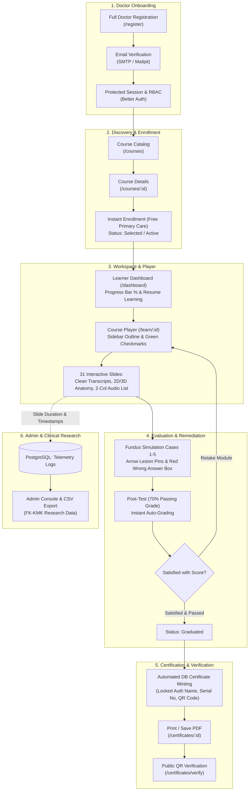

# STRATEGIC & PHASED IMPLEMENTATION BLUEPRINT: DRIVE-LEARN LMS (FK-KMK UGM)

> **Project:** DRIVE-Learn Interactive LMS Platform  
> **Partnership:** PT Tekno Global Infotama & Department of Ophthalmology, FK-KMK UGM  
> **Contract Reference:** Cooperation Agreement No. 001/PKS-TGI/VIII/2026 & 818/UN.1/FK-KMK.2/MT2/KS/2026  
> **Contract Value:** IDR 35,000,000 (Fixed Price, Non-VAT/Non-PKP)  
> **Timeline:** 16 Calendar Weeks (4 Months)  
> **Lead Software Architect & Tech Lead:** Ariefan Dipokusumo Wibowo, S.Kom., M.Cs.  

---

## 1. Executive Summary & Critical Context

The customer is the **Department of Ophthalmology, Faculty of Medicine, Public Health, and Nursing (FK-KMK) Universitas Gadjah Mada (DRIVE Program Team)**, led by **Prof. dr. Muhammad Bayu Sasongko, M.Epi., Ph.D., Sp.M**. This project delivers a targeted, specialized interactive e-learning platform for **Diabetic Retinopathy (DR) Screening tailored for Primary Care Doctors (Puskesmas & Pratama Clinics)** across Indonesia.

This is **not a generic bloated university LMS** burdened with forum threads, semester timetabling, or heavy campus RFID check-ins. It is an ultra-focused clinical delivery system:
1. High-yield medical training on diabetic retinopathy via lightweight 2D interactive slides.
2. Clinical fundus image grading simulation (microaneurysms, hard exudates, hemorrhages, neovascularization) with exact visual arrow feedback.
3. Strict standardized evaluation funnel: Pre-Test &rarr; Interactive Modules & Fundus Simulation &rarr; Post-Test &rarr; Retake Remediation &rarr; Automated Anti-Tamper Certification.
4. Append-only learning telemetry & analytics: per-slide dwell duration, interaction timestamps, and clinical grading attempts exported as raw CSV for FK-KMK clinical research publication.

---

## 2. 2D vs. 3D Eye Anatomy Clarification (Review Item #2)

Review note #2 explicitly states:
> **"Untuk anatomi mata saat ini yang akan digunakan hanya 2D saja"**  
> *(For eye anatomy, currently only 2D will be used)*

### Architectural Decision:
1. **Pragmatic Reality:** The customer explicitly designated **2D only** for this production release. Forcing a full 3D WebGL engine right now is a terrible idea: no calibrated 3D medical mesh has been provided by FK-KMK, bundle size would spike by 15MB+, and remote Puskesmas laptops running old Celerons/i3s would choke and freeze.
2. **Future-Proof Architectural Slot:** The `EyeAnatomyViewer` component is designed with a pluggable contract:
   ```ts
   interface EyeAnatomyViewerProps {
     mode?: "2d" | "3d"; // defaults to "2d"
     points: AnatomyPoint[];
     onSelectPoint: (point: AnatomyPoint) => void;
   }
   ```
   The platform defaults to an ultra-lean, responsive **Interactive 2D SVG Hotspot Stage** (<50KB, instant paint, zero lag). Whenever the DRIVE team delivers an approved `.glb` / `.gltf` 3D eye model, the `<ThreeEyeCanvas />` adapter drops right in without restructuring player layouts or scoring engines.

---

## 3. End-to-End LMS Lifecycle (10 Pillars from Registration to Certificate)



### Pillar Breakdown:
1. **Medical Identity & Onboarding (`/register`):** Collects full professional doctor credentials: Full Name with Medical Titles, Date of Birth, Clinical Profession (Primary Care Puskesmas Doctor, Clinic Doctor, Specialist, Resident), Institution/Clinic Name, Active WhatsApp/Phone, and Medical License / STR Number (Review #11).
2. **Catalog & Instant Enrollment:** Course discovery at `/courses` and overview at `/courses/$courseId`. For primary care doctors, enrollment is free and immediately sets `enrollments.status = 'selected'` with `progress = 0%`.
3. **Adaptive Learner Dashboard (`/dashboard`):** Real-time percentage progress bar, one-click *Resume Learning* linking directly to the last active slide, and immediate certificate claim link upon graduation.
4. **Interactive Course Player (`/learn/$courseId`):** Centered viewport-clamped container (`max-h-[calc(100vh-4.5rem)]`) preventing vertical scroll fatigue (Reviews #3 & #12). Modular sidebar outline with green completion checkmarks (`LessonCheck`).
5. **Clinical Fundus Simulation (Module 4):** Five interactive retinal fundus cases. Microaneurysm/hemorrhage lesions tagged with **SVG Arrow Pointers** with offset labels so lesions remain 100% visible (Review #7). Incorrect options turn **CRIMSON RED** (`bg-red-500/15 border-red-500 text-red-700`) while correct options turn green with medical rationale (Review #8).
6. **Assessment Engine (Pre & Post-Test):** 5-question baseline Pre-Test and 5-question competency Post-Test with automated grading and a 70% passing threshold.
7. **Completion, Score Confirmation & Retake Option:** Results summary displaying Pre-Test vs Post-Test comparison. Features the exact prompt: *"Are you satisfied with your score?"* and an unrestricted **Retake Module** button available to all participants (Review #9).
8. **Automated Anti-Tamper Certificate Minting:** Once passed and confirmed, the system flips enrollment to `graduated` and mints the certificate row atomically. **Recipient name is strictly locked to `users.name` from the authenticated session**—zero freeform text inputs, preventing credential spoofing (Review #10).
9. **Print PDF & Public QR Verification:** Rendered on `/certificates/$certificateId` as an official A4 landscape card with `@media print` stylesheets. Anyone (Health Office, Medical Association) can verify validity at `/certificates/verify?code=...` without logging in.
10. **Research Telemetry & Instructor Console:** Background beacon logs per-slide dwell times (`durationSeconds`, `enteredAt`, `exitedAt`) into `learning_telemetry_logs` (Review #15). The admin console provides a one-click raw CSV export for FK-KMK statistical research.

---

## 4. Comprehensive Per-Page & Per-Feature Curriculum Blueprint

The entire DRIVE-Learn curriculum consists of **6 Modules and 31 Interactive Slides/Pages**:

| No | Page ID | Slide | Type | Title / Topic | Specific Interactive Features |
|:--:|:---|:---:|:---:|:---|:---|
| 1 | `pengantar-p1` | 1 | `hero` | Course Launch: DR Screening for Primary Care | Clinical hero banner, voiceover welcome, Start CTA |
| 2 | `pengantar-p2` | 2 | `content` | Syllabus & Module Scope | 3 core pillars (DM, DR, Screening), formatted transcript |
| 3 | `modul1-p1` | 3 | `divider` | Chapter 1: Diabetes Mellitus | Chapter transition banner & introductory audio |
| 4 | `modul1-p2` | 4 | `content` | What is Diabetes Mellitus? | Multi-paragraph definition, Egregious Eleven modal |
| 5 | `modul1-p3` | 5 | `cards` | DM Prevalence & Case Projections | 3-column stats cards: Global numbers & Indonesia #5 rank |
| 6 | `modul1-p4` | 6 | `content` | DM Classification by Etiology | 4 etiologies (Type 1, Type 2, Gestational, Specific/MODY) |
| 7 | `modul1-p5` | 7 | `content` | **Risk Factors of Diabetes Mellitus** | **2-Column Grid + Audio-synced auto-reveal for 10 items (Reviews #5 & #6)** |
| 8 | `modul1-p6` | 8 | `content` | DM Diagnostic Criteria | PERKENI standard matrix (FPG, OGTT, HbA1c, RPG) |
| 9 | `modul1-p7` | 9 | `content` | Glucose & HbA1c Classification | Color-coded interpretation matrix (Normal to Diabetic) |
| 10 | `modul1-p8` | 10 | `content` | Diabetes Mellitus Complications | Microvascular (Retinopathy, Nephropathy) vs Macrovascular |
| 11 | `modul2-p1` | 11 | `divider` | Chapter 2: Diabetic Retinopathy | Chapter transition banner |
| 12 | `modul2-p2` | 12 | `hotspot` | **Interactive Eye Anatomy** | **2D SVG Hotspot Stage (11 points) + Pluggable 3D slot (Review #2)** |
| 13 | `modul2-p3` | 13 | `cards` | What is Diabetic Retinopathy? | Clinical summary card on retinal microvascular damage |
| 14 | `modul2-p4` | 14 | `content` | Diabetic Retinopathy Spectrum | Progression from NPDR to Proliferative DR (PDR) |
| 15 | `modul2-p5` | 15 | `hotspot` | **DR Pathophysiology Step 1-8** | **Explicit Instruction Banner + Sequential 1-to-8 Pulse Guide (Review #4)** |
| 16 | `modul2-p6` | 16 | `cards` | Clinical Symptoms of DR | Clinical warning: early stage is 100% asymptomatic |
| 17 | `modul2-p7` | 17 | `content` | Risk Factors of Diabetic Retinopathy | Duration of DM, glycemic control, hypertension, nephropathy |
| 18 | `modul2-p8` | 17b | `match` | Risk Factor Matching Game | Interactive drag-and-drop & touch pairing game |
| 19 | `modul3-p1` | 18 | `divider` | Chapter 3: Screening & Management | Chapter transition banner |
| 20 | `modul3-p2` | 19 | `content` | Visual Acuity & Referral Pathway | Snellen chart exam & FKTP-to-Ophthalmologist referral algorithm |
| 21 | `modul4-p1` | 20 | `divider` | Chapter 4: Fundus Grading Simulation | Simulation transition banner |
| 22 | `modul4-p2` | 21 | `image-grading` | Simulation Case 1: Normal Retina | High-res fundus, contrast adjustment, normal reasoning |
| 23 | `modul4-p3` | 22 | `image-grading` | **Simulation Case 2: Dot/Blot NPDR** | **SVG Arrow Markers (Review #7) + Red Wrong Answer Box (Review #8)** |
| 24 | `modul4-p4` | 23 | `image-grading` | Simulation Case 3: Moderate NPDR | Multiple microaneurysms detection with arrow pointers |
| 25 | `modul4-p5` | 24 | `image-grading` | Simulation Case 4: Macular Edema | Hard exudates around fovea with arrow pointers |
| 26 | `modul4-p6` | 25 | `image-grading` | Simulation Case 5: Proliferative DR | Disc neovascularization (NVD) detection with arrow pointers |
| 27 | `evaluasi-p1` | 26 | `divider` | Pre & Post Evaluation Assessment | Intro to 5 standardized doctor competency questions |
| 28 | `evaluasi-p2` | 27 | `quiz` | Q1: Diabetic Retinopathy Definition | Multiple choice clinical item with auto-grading |
| 29 | `evaluasi-p3` | 28 | `quiz` | Q2: Rescreening Interval for Normal Fundus | Periodic screening interval guidelines (1-2 years) |
| 30 | `evaluasi-p4` | 29 | `quiz` | Q3: Ischemia & VEGF Mediator | Pathophysiology of retinal ischemia triggering VEGF |
| 31 | `evaluasi-p5` | 30 | `quiz` | Q4: Screening vs Early Detection | Concept of screening asymptomatic target populations |
| 32 | `evaluasi-p6` | 31 | `quiz` | Q5: Primary Care Doctor Clinical Role | FKTP doctor boundaries vs vitreoretinal surgery |
| 33 | `selesai` | 32 | `completion` | **Graduation, Retake & Certification** | **Score satisfaction prompt & Retake (Review #9) + Locked Name Certificate (Review #10)** |

---

## 5. Proposed Codebase Changes by Package

### 1. `packages/ui` (Design Tokens & Theming)
- **`packages/ui/src/styles/globals.css`:** Inject DRIVE clinical colors into the Tailwind v4 / shadcn token theme:
  - `--clinical-navy: #173a5e;`
  - `--clinical-blue: #2d77c2;`
  - `--retina-teal: #5bb4b2;`
  - `--clinical-wrong: #c0392b;`
  - `--clinical-correct: #2c7a4b;`

### 2. `apps/api` (Database & Backend Services)
- **`apps/api/src/db/app-schema.ts`:**
  - Enhance `participantProfiles` with `profession`, `institutionName`, `strNumber`, `phone`, `birthDate`.
  - Add `learningTelemetryLogs` table (`id`, `userId`, `courseId`, `moduleId`, `slideId`, `enteredAt`, `exitedAt`, `durationSeconds`, `audioListenedSeconds`, `interactedElements`, `createdAt`).
- **`apps/api/src/modules/telemetry/`:**
  - `POST /v1/telemetry/heartbeat`: Ingests background beacons via `navigator.sendBeacon`.
  - `GET /v1/reports/telemetry/csv`: Generates and streams raw CSV telemetry reports for FK-KMK researchers.

### 3. `apps/app` (Frontend Application & Player Components)
- **`apps/app/src/routes/register.tsx`:** Updated registration form collecting full doctor metadata.
- **`apps/app/src/components/composed/player/clinical-fundus-grading.tsx`:** Fundus grader replacing circular pins with **SVG Arrow Pointers** and styling incorrect selections with **Crimson Red background**.
- **`apps/app/src/components/composed/player/interactive-slide-viewer.tsx`:** Core player supporting fit-to-screen viewports, 2-column auto-reveal animated lists, sequential 1-8 pulse guide, clean paragraph transcripts, audio narration bar, and 2D/3D anatomy viewer.
- **`apps/app/src/components/composed/player/completion-retake-card.tsx`:** Post-test completion screen offering score confirmation, retake trigger, and automated certificate issuance.

---

## 6. Phased Execution Schedule (Aligned with 4 PKS Milestones)

| Phase / Milestone | Deliverables Scope | Duration | Weight | Value (IDR) |
|---|---|:---:|:---:|---:|
| **Milestone 1 (Down Payment)** | SRS Document, Medical Design Tokens, Telemetry & Multi-Course DB Schema, 31-Slide Wireframes | Weeks 1 - 4 | 30% | IDR 10,500,000 |
| **Milestone 2** | Full Doctor Registration, Centered Fit-to-Screen Player, Module 1-2 Slide Engine, 2-Col Audio List, Audio Narration Bar | Weeks 5 - 8 | 30% | IDR 10,500,000 |
| **Milestone 3** | Fundus Grader (Arrow Pins & Red Error Box), Pre/Post Evaluation Engine, Retake Trigger, Locked Name Certificate, Telemetry Logging & CSV Export | Weeks 9 - 12 | 25% | IDR 8,750,000 |
| **Milestone 4 (Final)** | UAT with FK-KMK DRIVE Team, Dedicated Cloud VPS Deployment (Ubuntu 2 vCPU / 8 GB RAM / NVMe), 2 Online Training Sessions, User Manual & Final BAST | Weeks 13 - 16 | 15% | IDR 5,250,000 |
| **TOTAL** | **Full Completion of All PKS No. 001/PKS-TGI/VIII/2026 Deliverables** | **16 Weeks** | **100%** | **IDR 35,000,000** |

---

## 7. Verification & Testing Plan

1. **Automated Contracts & Quality Gates:**
   ```powershell
   node scripts/check-api-contract-parity.mjs
   pnpm --filter api typecheck
   pnpm --filter app typecheck
   pnpm format:check
   ```
2. **Clinical Usability Verification:**
   - **Slide 7 Auto-Reveal:** Verify 2-column layout and sequential unrolling synced to audio.
   - **Slide 12 Anatomy 2D/3D Slot:** Confirm 2D SVG hotspots load instantly without Three.js errors.
   - **Slide 15 Pathophysiology 1-to-8:** Verify explicit guidance and pulse sequential click guide.
   - **Module 4 Arrow Markers & Red Box:** Verify that clicking the wrong answer highlights the card in red and that arrow pins point to lesions without covering them.
   - **Post-Test Retake & Certification:** Pass post-test &rarr; confirm retake dialog works &rarr; claim certificate &rarr; verify recipient name is automatically locked to logged-in user &rarr; test print-ready layout &rarr; scan public QR verification code at `/certificates/verify` without login.
   - **Research CSV Export:** Download telemetry report from admin console &rarr; verify per-slide dwell seconds and timestamps are accurately recorded.
